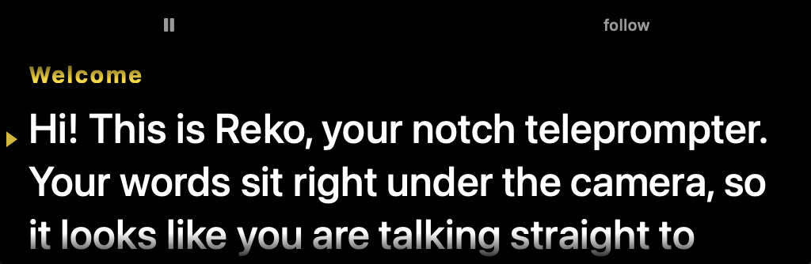
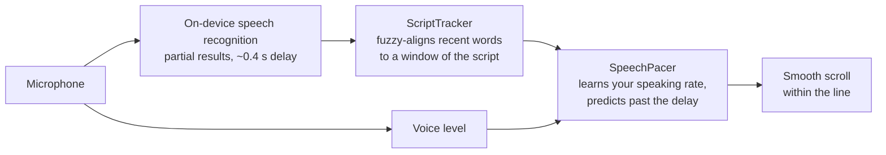

# Reko

**A teleprompter that lives in your MacBook's notch.** Your script sits right under the camera, so you look at the lens while you read. It follows your voice, waits when you pause, and stays out of your screen share.

<p align="center">
  
</p>

   

## Highlights

- **Follows your words.** On-device speech recognition tracks where you are in the script, word by word. Skip a sentence, ad-lib, or go back, and it keeps up. It runs about 0.2 s behind your voice.
- **Sits in the notch, or anywhere.** It grows out of the notch by default. Drag it out to any spot on any screen; drop it back under the notch to re-attach it.
- **Hidden from screen sharing.** The panel is excluded from screen capture, so your audience doesn't see your notes. [See the caveat](#limitations).
- **Control it your way.** Global keyboard shortcuts, clicking the prompter, your trackpad, or your phone (no app install).
- **Private.** Everything runs on your Mac. No account, no cloud, no analytics.

## Contents

- [Install](#install)
- [Quick start](#quick-start)
- [Writing a script](#writing-a-script)
- [Scroll modes](#scroll-modes)
- [Controls](#controls)
- [Phone remote](#phone-remote)
- [Settings](#settings)
- [How follow-my-words works](#how-follow-my-words-works)
- [Development](#development)
- [Limitations](#limitations)

## Install

Reko is built from source. You need macOS 14 or later and Xcode 15.3+ (or the Swift 5.10+ toolchain).

```sh
git clone https://github.com/kiranshivaraju/reko.git
cd reko
make run        # builds build/Reko.app and launches it
```

Copy `build/Reko.app` to `/Applications` to keep it. Reko is a menu-bar app: look for the speech-bubble icon (it has no Dock icon).

## Quick start

1. **Launch Reko.** The prompter appears in the notch and the **Script & Settings** window opens.
2. **Paste your script** into the editor on the left. It saves as you type.
3. **Pick a scroll mode** in the settings on the right (see [Scroll modes](#scroll-modes)).
4. **Press ⌃⌥Space** (or click the prompter). After a 3-second countdown, it starts scrolling.
5. **Press ⌃⌥Space again** to pause. **⌃⌥P** hides or shows the prompter.

The first time you use a voice mode, macOS asks for **Microphone** access, plus **Speech Recognition** for *Follow my words*.

## Writing a script

Scripts are plain text with two extras:

```markdown
# Intro
Hi everyone, thanks for joining. [smile]
Today I'll show you three things.

# Demo
Let's open the dashboard. [click Reports]
```

| Syntax | What it does |
|---|---|
| `# Heading` (any number of `#`) | Becomes a **cue**: shown in yellow, listed in the menu, the settings and the phone remote, and jumpable with ⌃⌥← / ⌃⌥→. |
| `[text in brackets]` | A **stage direction**: shown in teal, never expected to be read aloud. |
| Everything else | Your spoken text. |

The editor shows a word count and an estimated reading time. **Open…** reads `.md` or `.txt` files and **Save As…** writes `.md`. The working copy lives in `~/Library/Application Support/Reko/script.md`.

## Scroll modes

| Mode | Behaviour | Best for |
|---|---|---|
| **Constant** | Steady speed, adjustable live with ⌃⌥↑ / ⌃⌥↓. Hovering over the prompter pauses it. | Rehearsed reads, quiet rooms |
| **While talking** | Scrolls at your speed setting only while the mic hears you, and stops when you pause. | Natural pacing without tuning a speed |
| **Follow my words** | Listens and keeps the line you're reading on the marker, dimming what you've already said. Copes with skips, ad-libs and re-reads. | Presentations, talking to camera, going off-script |

In the voice modes, a **beam** along the bottom edge follows your voice level (green while you're talking). If background noise is triggering it, lower **Sensitivity**. Headphones help.

## Controls

| Action | Shortcut | Also |
|---|---|---|
| Play / pause | ⌃⌥Space | Click the prompter, menu bar, phone |
| Show / hide | ⌃⌥P | Menu bar, phone |
| Faster / slower | ⌃⌥↑ / ⌃⌥↓ | Phone |
| Next / previous cue | ⌃⌥→ / ⌃⌥← | Menu bar › Jump to Cue, settings, phone |
| Back to top | ⌃⌥R | Menu bar, phone |
| Move the text | — | Scroll on the prompter, phone ▲ / ▼ |
| Move the prompter | — | Drag it; drop it under the notch to re-attach |

Shortcuts work system-wide and don't need Accessibility permission. If another app already uses one, Settings › Shortcuts marks it as unavailable.

## Phone remote

Control Reko from any phone browser on the same Wi-Fi. No app to install.

1. Settings › **Phone remote** › turn on **Enable on local network** (allow the Local Network prompt).
2. Scan the QR code with your phone's camera.
3. You get Play/Pause, speed, cues, scrolling and Show/Hide. On iPhone, Share › **Add to Home Screen** makes it open like an app.

Reko runs a small web server on your Mac (port 8765) that only accepts requests carrying a secret token from the QR code. It's off by default and uses plain HTTP, so avoid using it on public Wi-Fi. If your network blocks devices from talking to each other (common on office or guest Wi-Fi), connect both to your phone's hotspot.

## Settings

| Section | Options |
|---|---|
| **Scrolling** | Mode, speed, mic sensitivity, speech language, pause on hover, countdown (off / 3 / 5 / 10 s) |
| **Display** | Notch or free position, text size, width, height, text colour, background (clear → solid), mirror text for beam-splitter teleprompter glass |
| **Cues** | Click to jump |
| **Phone remote** | On/off, QR code, link |
| **Shortcuts** | Reference list |

## How follow-my-words works



- **Tracking.** The last few recognized words are matched against the script around your current position. Matching tolerates misheard and half-finished words. Moving ahead needs a little evidence, and moving back needs more, so a stray "the" never sends it backwards.
- **Pacing.** Recognition arrives about 0.4 s late and in bursts. The pacer learns your words-per-second and moves slightly ahead of the last recognized word, but only while you're audibly talking and never more than 2 words ahead. So it doesn't lag, and it stops when you stop.
- **Scrolling.** The text glides through the reading line as you go, rather than jumping a line at a time.

This logic lives in `RekoCore`, which has no UI and is covered by unit tests.

## Development

```sh
make test       # 28 unit tests: script parsing, speech tracking and pacing, remote request handling
make run        # build build/Reko.app (universal: arm64 + x86_64) and relaunch it
make clean
```

```
Sources/RekoCore/          pure logic, unit-tested
  Script.swift               script → display text, spoken words, cues, directions
  ScriptTracker.swift        aligns recognized speech with the script
  SpeechPacer.swift          smooths and extrapolates position to hide recognizer delay
  RemoteRouter.swift         phone-remote HTTP parsing and token check
Sources/Reko/              the app (AppKit + SwiftUI)
  PrompterController.swift   hub: playback, scroll position, frame loop, commands
  PrompterPanel.swift        notch geometry, the panel, dragging, text layout
  MicListener.swift          mic level + speech recognition stream
  HotKeys.swift              global shortcuts (Carbon)
  RemoteServer.swift         local web server + phone page
  EditorView.swift           script editor and settings
  AppDelegate.swift          menu bar, windows, wiring
```

Every action is a `Command`: shortcuts, the menu, the editor and the phone remote all go through `PrompterController.perform(_:)`.

**Tips**

- **Permission prompts after every rebuild.** The build is ad-hoc signed, so macOS asks for mic and speech access again after each rebuild. Set `REKO_SIGN_IDENTITY` to a code-signing certificate (`security find-identity -p codesigning`) to keep the permissions across builds.
- **Screenshots or demo recordings.** Launch with `open --env REKO_CAPTURABLE=1 build/Reko.app` to make the prompter visible to screen capture.
- **Manual testing.** [TESTING.md](TESTING.md) has the hands-on test checklist (voice, permissions, displays, screen sharing, phone).

## Limitations

- **Screen capture.** Reko asks macOS to keep the panel out of captures, and Zoom, Meet, Teams and the built-in screenshot tools respect that. Some capture tools on macOS 15+ may still record it. Share a single window instead of the whole screen when it matters.
- **Languages.** Follow my words works with any language macOS speech recognition supports, including Chinese and Japanese. Languages written without spaces between words (Thai, Lao, Khmer, Burmese) aren't supported yet. Accuracy depends on the language and on room noise.
- **No recording.** Reko doesn't record your screen, camera or voice. Use your usual recording app alongside it.
- **Notch.** The notch position needs a notched MacBook. Other Macs, and external displays, use the free window.
